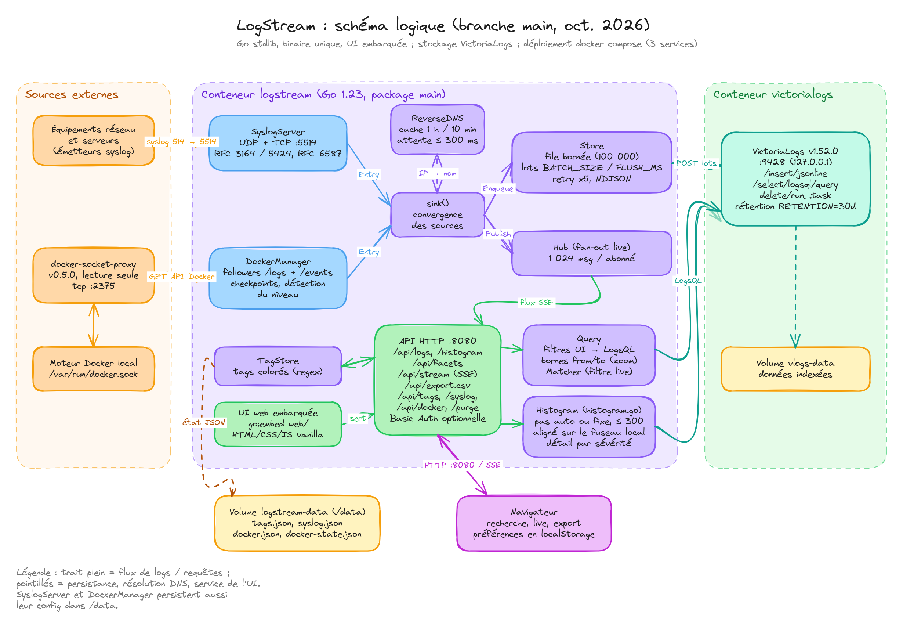

English | [Français](README.fr.md)

# Logstream

A simple syslog sink: receives logs over UDP/TCP on port 514, stores them in
[VictoriaLogs](https://docs.victoriametrics.com/victorialogs/), and serves a clean web
interface (light/dark theme, live search, live view, color tags, English/French UI).

```
devices ──514 udp/tcp──▶ logstream (Go) ──HTTP batches──▶ VictoriaLogs
                              ▲    └── SSE (live) ──▶ browser
                              └──── API / UI ◀─────────┘
```

## Architecture



- **Ingestion**: syslog (UDP/TCP) and Docker container logs both go through `sink()` (reverse DNS
  on IP hosts, without holding up the listeners), then the `Store` queue, which sends them in
  batches to VictoriaLogs. When VictoriaLogs is unreachable, batches are kept on disk
  (`/data/spool`, up to `SPOOL_MAX_MB`) and sent again, oldest first, once it is back.
- **Live view**: `sink()` also publishes each message to the `Hub`, which streams it to the
  browsers over SSE.
- **Search**: the HTTP API turns the UI filters into LogsQL queries sent to VictoriaLogs.
- **Timeline**: `/api/histogram` (`histogram.go`) counts the logs per interval and severity,
  aligned on the local time; the zoom bounds (`from`/`to`) also apply to the list and the export.
- **State**: tags and source settings live in `/data` (`logstream-data` volume); the logs
  themselves in the `vlogs-data` volume.

The editable source of the diagram is
[`docs/architecture.excalidraw`](docs/architecture.excalidraw)
(open it on [excalidraw.com](https://excalidraw.com)).

## Getting started

```bash
cp .env.example .env      # optional
docker compose up -d --build
./tools/send-test-logs.sh # sends 100 test messages
```

Then open <http://localhost:8080>.

## Sending logs

- **rsyslog** (Linux): add `*.* @SERVER_IP:514` (UDP) or `*.* @@SERVER_IP:514` (TCP)
  to `/etc/rsyslog.d/90-logstream.conf`, then run `systemctl restart rsyslog`.
- **Network gear, NAS, firewalls**: set the server IP and port 514 in their "remote syslog" settings.
- **Manual test**: `logger -n 127.0.0.1 -P 514 -d "hello error"` (util-linux) or
  `echo "<14>test ok" | nc -u -w1 127.0.0.1 514`.

**Settings > Sources > Syslog** turns syslog reception on or off and chooses the protocols
(UDP, TCP) without restarting; the choice is saved in `/data/syslog.json`. It also shows the
listening state (and the error if the port is already in use). The port itself is published
by docker-compose: change `SYSLOG_PORT` in `.env`, then run `docker compose up -d`.

Supported formats: RFC 3164 (BSD) and RFC 5424. Over TCP, both "one message per line"
and "octet counting" (RFC 6587) framing are accepted.

## Search

**Simple mode** (default): each word is matched as a case-insensitive substring of the
message, host and app. Words are combined with AND.

| Input | Meaning |
|---|---|
| `error disk` | contains "error" **and** "disk" |
| `"disk full"` | contains the exact phrase |
| `error -timeout` | contains "error" but not "timeout" |

**LogsQL mode** (`Simple` / `LogsQL` button): the full VictoriaLogs query language, e.g.
`error AND host:web-01`, `app:~"ssh|nginx"`, or `* | stats by (host) count()`.
The live view is disabled in this mode.

Each row shows, from left to right: the **reception time** (server clock), the timestamp
found in the message itself (`msg_time`), severity, host, app, codes of the tags found and message. Click a host or an
app to filter on it.

Logs are indexed, searched and sorted by **reception time**: devices with a wrong clock
(e.g. access points whose NTP fails) still show up in the right time range. Logs stored by
versions before this change are indexed by their message timestamp; purge them from
Settings to start clean.

Severity badges `err`/`crit` and `warning` use the colors of the `error` and `warning` tags.

Shortcuts: `/` focuses the search box, `Esc` clears it. Clicking a row shows all its fields.

The column headers stay visible while scrolling. Drag the edge of a header (received, message
time, severity, host, app) to resize the column, double-click it to go back to the automatic
width; the message takes the remaining space. Widths are remembered by the browser
(**Settings > Interface > Reset column widths** restores them all). On phones the list keeps its
two-line layout without columns.

## Timeline

The timeline above the list shows the volume of logs per interval, counted by **reception
time** on the server clock (so it matches the times shown in the rows).

- Hover an interval: its bounds, total and detail per severity.
- Click a bar to zoom on that interval, or drag across several bars to zoom on the selection.
  The time range then shows the zoomed period ("× Reset zoom" or any other range leaves it);
  the list, the counters and the CSV export follow the zoom, and the live view pauses.
- In live mode the last interval grows as messages arrive, and the timeline reloads at each new
  interval. Nothing is refreshed while the browser tab is hidden; it catches up when shown again.

**Settings > Interface > Timeline** (remembered per browser): scale (linear, √ by default, log),
height (S/M/L: 40/80/120 px), color (stacked by severity, intensity compared with the median of
the window: calm, burst above 3×, anomaly above 10×, or none), bars or area, division
(automatic, about 100 intervals, or fixed: 1 s, 10 s, 1 min, 5 min, 1 h, 1 day) and refresh
(off, 5 s, 15 s, 30 s, 1 min, or at each new interval). A fixed division that would exceed
300 intervals over the range is enlarged (shown as "enlarged"). Intervals are aligned on the
local time of the time zone chosen in Settings (days start at local midnight).

API: `curl 'localhost:8080/api/histogram?range=24h&step=auto&tz=Europe/Paris'` returns
`step` (ms), `start` (ms), `count`, `now` (server clock) and the non-empty `buckets`
(`i` = interval index, `n` = total, `sev` = count per severity). Every log endpoint also accepts
`from` / `to` (Unix milliseconds) instead of `range`.

## Docker container logs

Logstream also collects the logs of the Docker containers running on the machine where it is
installed (`DOCKER_LOGS=on`, the default in `docker-compose.yml`). They are searched, filtered,
colored and exported like syslog messages:

- **host** is the Docker host name, **app** the compose service (or the container name), and
  each log also carries `container`, `container_id`, `image`, `compose_project`,
  `compose_service` and `stream` (stdout/stderr), visible in the row details.
- The **Source** filter shows only syslog or only Docker logs; Docker rows have a small cube
  before the app name, colored like its compose project.
- The severity comes from the line itself when the application writes it: JSON
  (`"level":"error"`), logfmt (`level=warn`), `[ERROR]`, or an upper-case level word at the
  start of the line (`ERROR`, `WARN`…). Otherwise it is `info`. Terminal color codes are removed.
- **Settings > Sources** shows one label per container (`project/service`) in a single field:
  followed containers in color, then not followed ones in grey; a click switches a label.
  The color identifies the compose project, and Docker app names in the log list use the
  same color. Stopped containers are hidden by default ("Show stopped containers" displays
  them, dashed, and they stay editable). A filter box and "Enable all" / "Disable all" (applied
  to the labels shown) help with many containers. New containers are followed automatically
  unless that option is turned off. Choices are saved per compose service (or container name)
  in `/data/docker.json`, so they survive re-creations.
- Logstream remembers the position of the last line stored for each container
  (`/data/docker-state.json`): after a restart it resumes without losing lines. The position
  only moves once a line is in VictoriaLogs or in the disk buffer, and a full queue slows the
  reading down instead of dropping lines. A container seen for the first time
  is read from `DOCKER_BACKFILL` ago (1 hour by default).
- Logstream itself and the proxy below are never collected; add the label
  `logstream.exclude=true` to any other container to exclude it for good.

**Security**: access to the Docker socket is equivalent to root on the machine. Logstream
therefore goes through [docker-socket-proxy](https://github.com/Tecnativa/docker-socket-proxy),
which only lets through listing containers, reading logs, events and engine info (`GET` only).

## Host system logs

Logstream can also collect the system logs of the machine hosting the stack, without
configuring anything on the host. The source is **off by default**: turn it on in
**Settings > Sources > Host system logs** (saved in `/data/hostlogs.json`).

- `docker-compose.yml` mounts `/var/log` and `/run/log/journal` read-only under `/host`.
- When the host runs systemd, Logstream reads the **systemd journal** files directly (no
  `journalctl` needed in the image): **host** is the machine name, **app** the program
  (`SYSLOG_IDENTIFIER`), severity and facility come from the journal, and the systemd unit is
  kept in `unit`. Otherwise it follows the text files of `/var/log` (`syslog`, `messages`,
  `*.log`), parsed like syslog lines, with the file name in `log_file`.
- These logs have the `host` source: the **Source** filter shows them alone.
- When the source is turned on, the last hour is read first (`HOST_LOGS_BACKFILL`); the
  position reached is saved in `/data/hostlogs-state.json`, so a restart neither loses nor
  duplicates entries.
- **Permissions**: the container runs as an unprivileged user and gets the `adm` group
  (gid 4), which can read the journal and `/var/log` on Debian and Ubuntu. On other systems,
  set `HOST_LOGS_GID` in `.env` to the gid of `systemd-journal`
  (`getent group systemd-journal | cut -d: -f3`). Settings > Sources shows a clear message when
  access is denied.
- Limits: journal fields compressed by journald (messages longer than 512 bytes, compressed
  with zstd/lz4/xz) cannot be decoded without extra libraries; they are counted in Settings and
  shown as "(compressed journal entry)". Rotated or compressed text files (`*.1`, `*.gz`) are
  not read.

## CSV export

The **Export** button (next to the log count) downloads every stored log matching the
current filters (search, time range, severity, host, app), newest first, up to `EXPORT_MAX`
rows (100,000 by default), not only the rows on screen. Two variants:

- **CSV**: comma separated, UTF-8.
- **CSV for Excel**: semicolon separated with a UTF-8 BOM, so French Excel opens it directly
  with accents. Cells starting with `=`, `+`, `-` or `@` are prefixed with `'` so that a
  crafted log message cannot run as a formula.

Columns: `received`, `message_time` (both as `YYYY-MM-DD HH:MM:SS.mmm` in the time zone
chosen in Settings), `severity`, `facility`, `host`, `host_ip`, `app`, `pid`, `source_ip`,
`proto`, `message`. In LogsQL mode, only the filter part is supported (no `| pipes`).

From the command line: `curl -o logs.csv 'localhost:8080/api/export.csv?q=error&range=24h&tz=Europe/Paris'`.

## Settings

The gear icon opens the settings, organized in tabs. Everything except color tags is
remembered per browser.

- **Localization**
  - *Language*: English or French.
  - *Date & time*: time zone (browser zone, UTC, or about 80 common zones) and the display
    format of the reception time: `DD/MM/YYYY HH:MM:SS` (default, the usual French display),
    with milliseconds, `YYYY-MM-DD`, 12-hour clock, ISO 8601 or Unix epoch. The time zone
    applies to every date shown.
- **Filters**: color tags. Each tag has a keyword, a background color (the text automatically
  switches to black or white to stay readable) and options: whole word, match case,
  regular expression, active. Tags are stored on the server in `/data/tags.json`
  (`logstream-data` volume), so they are shared by every browser. Default tags (pastel):
  `warning` (orange) and `error` (red); `ok` (green) is in the *Log levels* preset. Default
  tags still using the colors of earlier versions are switched to the pastel ones
  automatically.
  The *+ Preset…* menu adds ready-made tags: HTTP/HTTPS access logs (status codes, methods,
  probes, bots, TLS and proxy errors), system logs (SSH, sudo, kernel, systemd, firewall),
  applications (Docker, databases) and general patterns (log levels, IPv4 addresses). Tags
  already in the list are skipped, and the added tags can be edited like any other. The list
  comes from a text file you can edit (`PRESETS_FILE`): see [docs/presets.md](docs/presets.md)
  for each preset and the file format. In a regular expression, a group named `hl`
  (`(?<hl>…)`) colors only that part of the match: the presets use it to color the status code
  or the method, not the text around it.
  Each tag gets a two-digit code (`01`, `02`…) assigned by the server: it stays with the tag
  until the tag is deleted (codes are also given to tags created by earlier versions). The
  *Filters* column of the log list shows, as grey badges, the codes of the active tags found in
  each message; it has room for 3, beyond that it shows 2 and `+N`, and the tooltip lists them
  all.
- **Interface**
  - *Theme*: System (follows the computer/phone preference), Light or Dark. The sun/moon
    button in the header switches between light and dark.
  - *Log display*: font size (tiny, small, medium, large), density (normal, or compact to
    fit about 50% more lines on screen) and font: the system monospace font, one of 3 narrow
    built-in fonts served by LogStream itself, which work offline (Inconsolata Condensed, the
    narrowest, Iosevka and Ubuntu Mono), or one of 11 free fonts made for dense text (JetBrains
    Mono, Fira Code, Source Code Pro, IBM Plex Mono, Cascadia Code, Roboto Mono, Inconsolata,
    Red Hat Mono, Noto Sans Mono, Victor Mono, DM Mono). These 11 are loaded by the browser from
    [Bunny Fonts](https://fonts.bunny.net), a privacy-friendly European font service; without
    internet access, the system font is used. Ligatures are disabled so `->` or `!=` show as
    typed. The densest setting is Tiny + Compact + Inconsolata Condensed.
- **Data**: database figures read from VictoriaLogs (refreshed at most every 30 s): stored
  lines, size on disk (index included), raw size and compression ratio, period covered with
  the retention, lines of the last 24 h and last hour, distinct hosts and apps, free disk
  space. Sizes use KB/MB/GB (Ko/Mo/Go in French). "Delete all logs" permanently erases every stored log (you must type
  `PURGE` to confirm). Tags and settings are kept. VictoriaLogs needs `-delete.enable`
  (already set in `docker-compose.yml`). The feature is off by default: set `ALLOW_PURGE=true`
  to allow it. Any admin can then purge: turn on [authentication](#authentication) if the UI
  is reachable by others.

## Authentication

`AUTH_MODE` picks how the UI and the API are protected (`/healthz` always stays open):

- **`local`** (default): a login page with the account `AUTH_USER` / `AUTH_PASS`; leave them
  empty to have no authentication (for instance behind a reverse proxy that already checks). The
  UI then shows a warning banner, which can be closed.
- **`oidc`**: login through an OpenID Connect provider (Keycloak, Authentik, Authelia, Zitadel…),
  authorization code flow with PKCE.

In `local` mode the login page follows the theme and language of the UI. The session lasts
`SESSION_TTL` (12 h by default), survives restarts (its signing key is in `/data/session.key`) and
ends when `AUTH_USER` or `AUTH_PASS` changes; the log out button (top right) ends it. Failed logins
are written in the logs with the client address (`auth: failed login for "bob" from 192.0.2.7`).
Scripts can still call the API with HTTP Basic credentials (`curl -u user:pass`).

An optional **read-only account**, `AUTH_VIEWER_USER` / `AUTH_VIEWER_PASS`, can search, follow
the live view and export, but cannot change tags, sources or purge: those settings are greyed
out in its UI and the API answers `403`.

To show your logo on the login page, mount a PNG in the container and point `LOGIN_LOGO` to it:

```yaml
# docker-compose.yml, logstream service
    volumes:
      - ./logo.png:/config/logo.png:ro
```
```bash
# .env
LOGIN_LOGO=/config/logo.png
```

To use OIDC:

1. In the provider, create a **confidential** client (with a secret) for logstream and register
   the redirect URL `https://logs.example.org/auth/callback` (your address).
2. In `.env`:
   ```bash
   AUTH_MODE=oidc
   OIDC_ISSUER=https://sso.example.org/realms/home      # exactly the "issuer" of the provider
   OIDC_CLIENT_ID=logstream
   OIDC_CLIENT_SECRET=...
   OIDC_REDIRECT_URL=https://logs.example.org/auth/callback
   ```
3. `docker compose up -d`. The logs show `oidc authentication enabled`, or the reason the
   provider could not be read (wrong issuer, unreachable…).

Opening the UI sends you to the provider's login page, then back to logstream. The session
lasts `SESSION_TTL` (12 h by default) and survives restarts (its signing key is in
`/data/session.key`); when it ends, the page goes through the login again. The log out button
(top right) ends the logstream session, then opens the provider's log out page if it has one.

Every user the provider accepts for this client can log in: restrict access in the provider
(Keycloak: client roles or a dedicated realm; Authentik: application bindings). Logins are written
in the logstream logs (`oidc: alice logged in`). With an `https` redirect URL, the cookies are
only sent over HTTPS: logstream must be reached through a TLS reverse proxy.

To give read-only access to some users, set `OIDC_ADMIN_GROUP` (for instance
`logstream-admins`): only its members are admins, the others are read-only. The groups are read
from the `groups` claim of the ID token (`OIDC_GROUPS_CLAIM` to use another one); in Keycloak,
add a "Group Membership" mapper to the client (a leading `/` is ignored).

Whatever the mode, every answer carries security headers (Content-Security-Policy,
X-Frame-Options…), and the API refuses changes sent from another site (cross-site requests).

## Host names (reverse DNS)

When a device sends its IP address as host name (or no host name at all), Logstream looks up
its DNS name (PTR record) and stores the name in `host` and the IP in `host_ip`. Results are
cached (1 hour, 10 minutes when there is no name). Logs stored earlier with an IP are resolved
on display, and the host filter shows `name (IP)`.

The container uses Docker's DNS, which forwards to the host's resolvers. If your local names
are only known by your router or a local DNS (Pi-hole, AdGuard, Unbound…), set
`DNS_SERVER=192.168.1.1` (its address). Set `RDNS=off` to disable lookups.

## Configuration

| Variable | Default | Purpose |
|---|---|---|
| `SYSLOG_PORT` | `514` | syslog port published on the host |
| `HTTP_PORT` | `8080` | web UI port |
| `RETENTION` | `30d` | how long VictoriaLogs keeps logs |
| `AUTH_MODE` | `local` | `local` (login page) or `oidc`, see [Authentication](#authentication) |
| `AUTH_USER` / `AUTH_PASS` | empty | account of the login page (`local` mode); empty = no authentication |
| `AUTH_VIEWER_USER` / `AUTH_VIEWER_PASS` | empty | optional read-only account (`local` mode) |
| `LOGIN_LOGO` | empty | PNG shown on the login page, path inside the container (`local` mode) |
| `SESSION_TTL` | `12h` | session lifetime (both modes; `OIDC_SESSION_TTL` still works) |
| `OIDC_ISSUER` | empty | issuer URL of the OpenID Connect provider (`oidc` mode) |
| `OIDC_CLIENT_ID` / `OIDC_CLIENT_SECRET` | empty | client registered in the provider |
| `OIDC_REDIRECT_URL` | empty | callback URL of logstream, e.g. `https://logs.example.org/auth/callback` |
| `OIDC_SCOPES` | `openid profile email` | requested scopes |
| `OIDC_ADMIN_GROUP` | empty | only members of this group are admins, the others read-only (empty = everyone is admin) |
| `OIDC_GROUPS_CLAIM` | `groups` | ID token claim that lists the groups |
| `RDNS` | `on` | resolve IP hosts to DNS names |
| `DNS_SERVER` | empty | DNS server for reverse lookups (`ip` or `ip:port`) |
| `ALLOW_PURGE` | `false` | allow "Delete all logs" in Settings |
| `SYSLOG_TCP_MAX_CONNS` | `512` | syslog TCP connections open at once; more are refused |
| `SYSLOG_TCP_IDLE` | `30m` | a syslog TCP connection silent this long is closed (senders reconnect) |
| `EXPORT_MAX` | `100000` | maximum number of rows in a CSV export |
| `PRESETS_FILE` | `/data/presets.json` | color tag presets file; the built-in list when missing (see [docs/presets.md](docs/presets.md)) |
| `DOCKER_LOGS` | `on` in compose | collect the logs of the local Docker containers |
| `DOCKER_HOST` | `tcp://docker-proxy:2375` in compose | Docker API address (`unix:///var/run/docker.sock` outside compose) |
| `DOCKER_BACKFILL` | `1h` | history read from a container seen for the first time |
| `HOST_LOGS_GID` | `4` (adm) in compose | group given to the container to read the host logs |
| `HOST_LOGS_BACKFILL` | `1h` | history read when the host system logs source is turned on |
| `HOST_LOGS_ROOT` | `/host` | where the host directories are mounted |
| `TZ` | `Europe/Paris` | time zone for RFC 3164 timestamps (which carry none) |
| `BATCH_SIZE`, `FLUSH_MS`, `QUEUE_SIZE` | `1000`, `1000`, `100000` | ingestion tuning |
| `SPOOL_MAX_MB` | `1024` | disk buffer size for batches VictoriaLogs could not take (`0` = no buffer: retried for 15 s, then dropped) |

## Debugging

- `docker compose logs -f logstream`: receive errors and errors sending to VictoriaLogs.
- The bottom bar shows received / stored / dropped counters, the messages waiting in the disk
  buffer, and the last storage error.
- <http://localhost:9428/select/vmui>: VictoriaLogs' own UI to try LogsQL queries.
- API:
  ```bash
  curl 'localhost:8080/api/logs?q=error&range=1h&limit=5'   # the response includes the generated LogsQL query
  curl localhost:8080/api/stats
  curl localhost:8080/api/tags
  ```
- Running outside Docker (Go 1.22+): `VLOGS_URL=http://localhost:9428 DATA_DIR=./data SYSLOG_ADDR=:5514 go run .`

## Updating

Every image version is pinned, so a `docker compose pull` or a rebuild never changes a
component behind your back:

| Where | Image | Version |
|---|---|---|
| `docker-compose.yml` | `victoriametrics/victoria-logs` | `v1.52.0` |
| `docker-compose.yml` | `tecnativa/docker-socket-proxy` | `v0.5.0` |
| `Dockerfile` (build) | `golang` | `1.27.1-alpine3.24` |
| `Dockerfile` (runtime) | `alpine` | `3.24.2` |

To update one of them:

1. Check the release notes: [VictoriaLogs](https://docs.victoriametrics.com/victorialogs/changelog/),
   [docker-socket-proxy](https://github.com/Tecnativa/docker-socket-proxy/releases),
   [Go](https://go.dev/doc/devel/release), [Alpine](https://alpinelinux.org/releases/).
   VictoriaLogs keeps its storage format across minor versions; read the changelog before a
   major version change.
2. Change the version in the file above, then run `docker compose up -d --build`.
3. Check the bottom bar (received / stored / dropped) and **Settings > Sources**. To go back,
   restore the previous version and run the same command.

## Code layout

| File | Contents |
|---|---|
| `main.go` | configuration, startup |
| `auth.go` | authentication: OpenID Connect (discovery, PKCE, ID token checks) and the signed session cookie |
| `auth_local.go` | `local` mode: login page (`web/login.html`), session cookie, `LOGIN_LOGO` |
| `syslog.go` | UDP/TCP listeners and RFC 3164 / 5424 parsing |
| `store.go` | batched inserts into VictoriaLogs and LogsQL queries |
| `query.go` | turns UI filters into LogsQL; live-view filter |
| `histogram.go` | timeline: division, interval alignment, `/api/histogram` |
| `hub.go` | pushes new messages to browsers (SSE) |
| `rdns.go` | cached reverse DNS lookups |
| `export.go` | streamed CSV export |
| `docker.go` | Docker container logs (API, followers, positions, level detection) |
| `syslogserver.go` | syslog listeners opened and closed from Settings > Sources |
| `hostlogs.go`, `journal.go` | host system logs: systemd journal reader (no `journalctl`) and `/var/log` follower |
| `tags.go` | color tag storage |
| `presets.go`, `presets.json` | color tag presets (`/api/presets`), built-in list |
| `api.go` | `/api/*` HTTP routes |
| `web/` | UI (HTML, CSS, plain JavaScript, no build step), embedded in the binary; translations live in `web/app.js` (`I18N`), and in `web/login.html` for the login page |

## Note

With Docker Desktop (macOS/Windows), the source IP seen by the container for UDP packets is
the Docker gateway. The `host` field still comes from the syslog header, which normally
carries the sender's real name.
